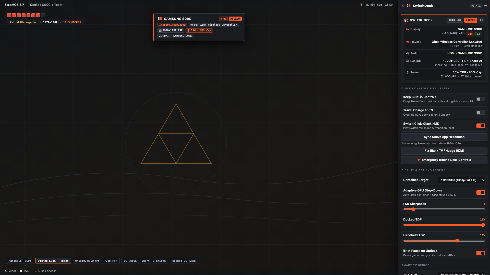
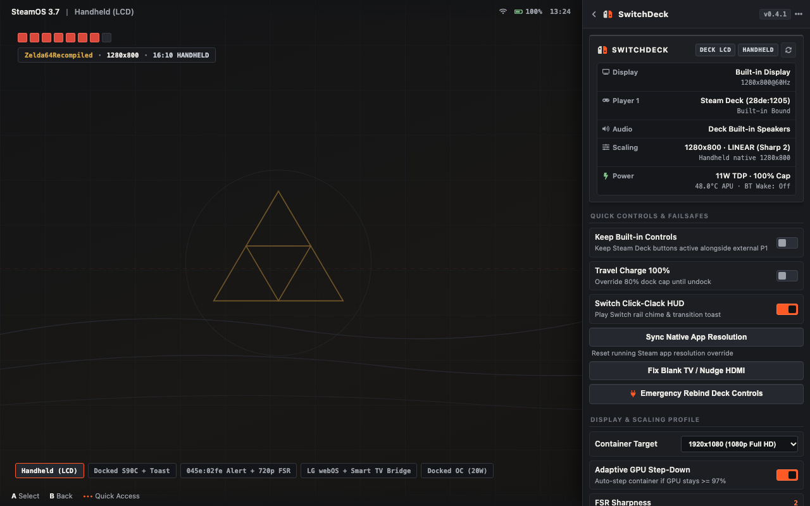
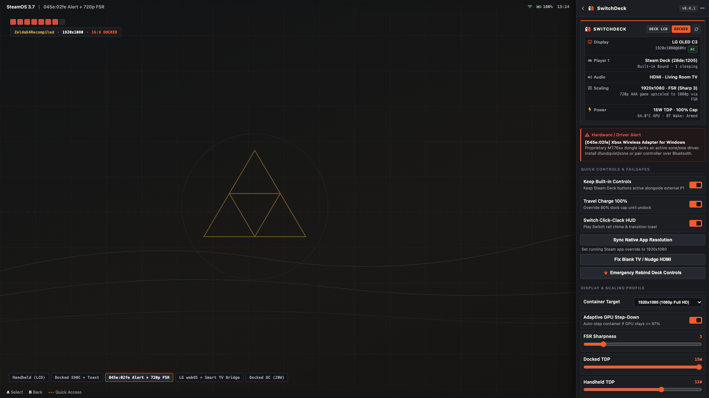
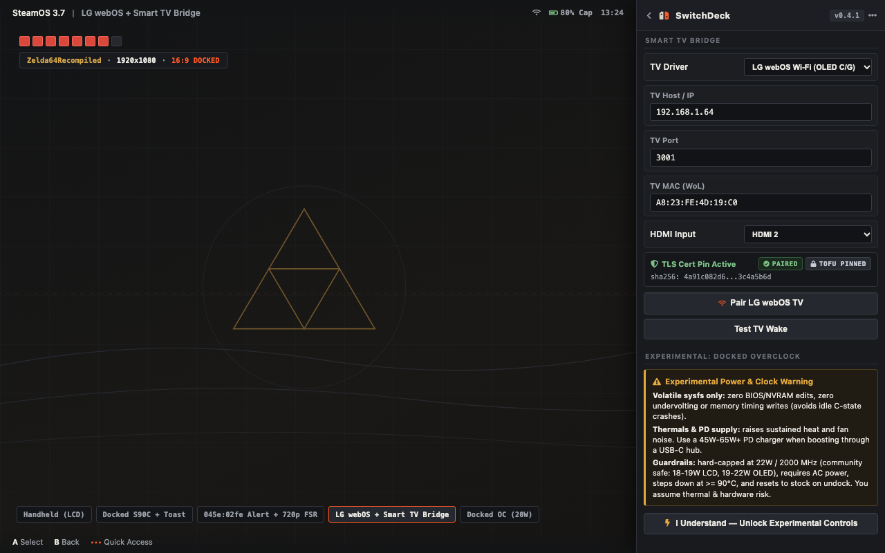
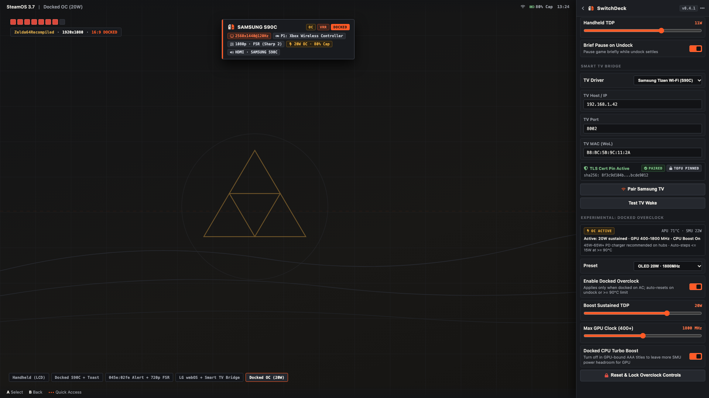

# SwitchDeck

**Universal Nintendo Switch–style docking daemon and Decky Loader plugin for Steam Deck (LCD `Jupiter` & OLED `Galileo`) and SteamOS.**

SwitchDeck coordinates controller Player-1 handoffs (`28de:1205` Neptune bind/unbind), live Gamescope resolution/FSR scaling, PipeWire audio routing with split handheld/docked volumes, `steamos-manager` TDP & 80% battery charge caps, LCD dock-gated Bluetooth wake, and universal HDMI-CEC + Wi-Fi Smart TV switching — with **zero external Python runtime dependencies** (`Python 3.10+` stdlib only).



*Docked on Samsung S90C (`2560x1440@120Hz VRR`): Switch Click-Clack SteamOS OLED industrial HUD toast + SteamOS Quick Access Menu (`•••`) showing 2.4GHz Xbox Player-1 promotion, `1080p -> 1440p` FSR scaling, and `80%` battery charge cap.*

---

## Quick Demo & Tests (macOS / Linux Without a Steam Deck)

Run the simulated LCD `Jupiter` + USB-C hub + sleeping 2.4GHz Xbox dongle + Samsung S90C transition:

```bash
PYTHONPATH=src python3 -m switchdeck.cli demo
```

Run the full automated verification suite (**39 `unittest` cases**):

```bash
PYTHONPATH=src python3 -m unittest discover -s tests -v
```

Build the Decky frontend, preview bundle, and installable Decky Loader ZIP:

```bash
npm run typecheck && npm run build && npm run preview && ./scripts/build_decky_zip.sh
```

---

## Installing on Your Steam Deck

### Option A — Decky Loader Plugin ZIP (Recommended for Game Mode)

1. Use the direct release URL `https://github.com/topuchi13/SwitchDeck/releases/latest/download/SwitchDeck.zip`, or build `dist-zip/SwitchDeck-v0.4.1.zip` locally via `./scripts/build_decky_zip.sh`.
2. On your Steam Deck in **Game Mode**, open **Settings -> System -> Enable Developer Mode**.
3. Open **Settings -> Developer -> Install Plugin from URL** and paste the release URL above, or choose **Install Plugin from ZIP** and select `SwitchDeck-v0.4.1.zip`.
4. Open the **Quick Access Menu (`•••`) -> Decky -> SwitchDeck**.

The packaged plugin (`plugin.json` with `"flags": ["root"]`, `main.py`, `dist/index.js`, and `py_modules/switchdeck/`) runs an in-process `AF_NETLINK` uevent listener + 1.5s observer loop directly inside Decky Loader, resolves the `deck` user session for PipeWire/Gamescope/`steamosctl`, stores profiles/tokens in `DECKY_PLUGIN_SETTINGS_DIR` (`0600`), and unconditionally rebinds `28de:1205` in `_unload()` / `_uninstall()`.

### Option B — Standalone Systemd Daemon (No Decky Required)

Deploy from macOS/Linux over SSH (`passwd` + `sudo systemctl enable --now sshd` on Deck first):

```bash
./scripts/deploy_deck.sh deck@steamdeck.local
```

Or install directly on Steam Deck:

```bash
bash ./scripts/install.sh
~/.local/bin/switchdeckctl doctor
```

Uninstall cleanly (stops service and restores `28de:1205`):

```bash
bash ./scripts/uninstall.sh
```

---

## Switch Click-Clack HUD Toast & Quick Access Menu (QAM)

| Handheld Mode (`1280x800` LCD) | Hardware / Driver Alert (`045e:02fe`) | LG webOS & TOFU TLS Smart TV Bridge |
| :---: | :---: | :---: |
|  |  |  |
| Built-in `28de:1205` bound, `11W` TDP, LCD BT wake locked off | Actionable remediation when `xone`/`xow` driver is missing | Multi-brand TV drivers, HDMI port selector & SHA-256 TOFU cert pin badges |

- **Switch Click-Clack HUD Toast:** Docking or undocking emits `switchdeck_transition`, playing a synthesized Switch-style rail chime (`src/ui/audioChime.ts`) and displaying an industrial HUD toast (`SwitchToastCard`) summarizing the display, output mode, VRR badge, Player-1 controller, scaling filter, TDP/charge cap, and audio sink.
- **Hero Status & Alerts:** Displays `Deck LCD` / `Deck OLED`, `Docked` / `Handheld` status, output mode (`VRR`/`AC` pills), Player-1 controller state, active scaling, TDP/charge cap, LCD BT Wake lock state, and actionable warnings (such as proprietary `045e:02fe` Xbox adapters missing `xone`/`xow`).
- **Quick Controls & Failsafes:**
  - **Keep Built-in Controls** (resets automatically on undock) & **Emergency Rebind Deck Controls**
  - **Travel Charge 100%** (overrides 80% dock battery cap until undock)
  - **Switch Click-Clack HUD** chime/toast toggle
  - **Sync Native App Resolution** (`SteamClient.Apps.SetAppResolutionOverride`) & **Fix Blank TV / Nudge HDMI** (`GAMESCOPE_DISPLAY_MODE_NUDGE`)
- **Display & Scaling Profile:** Per-EDID Container Target (`1080p`, `1440p`, `720p`), **Adaptive GPU Step-Down** (`>= 97%` GPU busy), **FSR Sharpness** (`0–20`), **Docked TDP** (`3–15W` stock cap; boosted docked TDP lives under **Experimental: Docked Overclock**), **Handheld TDP** (`3–15W`), and **Brief Pause on Undock**.
- **Smart TV Bridge:** Select `HDMI-CEC`, `Samsung Tizen Wi-Fi (S90C)`, `LG webOS Wi-Fi (OLED C/G)`, `Sony Bravia LAN (PSK)`, `Roku TV LAN (ECP)`, `Wake-on-LAN Only (Any TV)`, `Home Assistant / Webhook`, or `Disabled`; select target **HDMI Input** (`HDMI 1`–`HDMI 4`, `AV 1`), inspect `Paired` / `TOFU Pinned` SHA-256 certificate or `PSK Saved` status cards, pair/verify, or test TV wake.
- **Experimental: Docked Overclock:** Locked behind an explicit acknowledgment banner until unlocked; adds **Community Presets**, **Enable Docked Overclock** toggle, **Boost Sustained TDP** (`15–22W`), **Max GPU Clock** (`Stock Auto` or `400–2000 MHz`), **Docked CPU Turbo Boost** toggle, live APU temp/SMU max telemetry, and **Reset & Lock Overclock Controls**.

---

## Experimental: Docked Overclock (Volatile Runtime)

> [!WARNING]
> **Experimental Feature & Liability Disclaimer:** Pushing a Steam Deck APU above Valve's stock `15W` / `1600 MHz` envelope increases sustained thermals, fan acoustics, VRM (`MAX77961`) stress, and USB-C PD charger draw, and may still cause thermal throttling or game instability depending on silicon lottery and dock power delivery. You explicitly unlock these controls at your own risk; SwitchDeck defaults `overclock.enabled = false` (`<= 15W` stock) and never persists boosted limits across undock, reboot, or uninstall.



*Docked on Samsung S90C (`Galileo` OLED, `20W` Boosted TDP, `GPU 400–1800 MHz`, `2560x1440@120Hz VRR`): Switch Click-Clack HUD toast with `OC` badge + Decky QAM telemetry card, presets, and sliders.*

### Community Overclocking Research & Built-in Guardrails

SwitchDeck's docked boost mode incorporates failure modes and thermal limits documented by the Steam Deck overclocking community:

| Mechanism / Board Variant | Community Finding & SwitchDeck Guardrail |
| :--- | :--- |
| **Zero Undervolt & Zero NVRAM Edits** | Curve/SVI3 undervolts (`-30mV` to `-50mV`) and `Smokeless UMAF` / `setup_var` CMOS edits commonly pass heavy benchmarks yet crash in idle C-states or require CMOS recovery. SwitchDeck writes **zero NVRAM variables** and applies **zero voltage offsets**, using only volatile Linux runtime `sysfs` (`power1_cap`/`power2_cap`, `pp_od_clk_voltage`, `cpufreq/boost`). |
| **Deck LCD (`Jupiter`, 7nm Van Gogh)** | Community sweet spot is **`18–19W`** sustained TDP and **`1700–1750 MHz`** GPU peak (PMIC/VRM runs warmer above `19–20W`). Default preset **`LCD 18W · 1700MHz`**. |
| **Deck OLED (`Galileo`, 6nm Sephiroth)** | Cooler 6nm process & improved fan curve sustain **`19–22W`** TDP and **`1800–1900 MHz`** GPU peak reliably. Hard software cap is **`22W`** (further clamped by kernel `power1_cap_max`). Default preset **`OLED 20W · 1800MHz`**. |
| **Dynamic GPU Floor (`400..Max`)** | Locking minimum GPU clocks high starves Zen 2 cores under tight SMU power budgets. When custom GPU peak (`1650–2000 MHz`) is set, SwitchDeck writes `s 0 400` and `s 1 <MHz>` in `pp_od_clk_voltage` so idle/loading states scale down normally. |
| **Docked CPU Turbo Boost Toggle** | In GPU-bound AAA titles, disabling `cpufreq/boost` stops Zen 2 boost spikes from stealing SMU power budget away from RDNA2 CUs (**`AAA 19W · No Boost`** preset). |
| **`45W–65W+` USB-C PD Hub Supply** | Budget hubs siphon `5–15W` for HDMI/USB controllers. SwitchDeck **refuses overclock whenever `ac_online` is false** (including mid-session PD brownouts/disconnects). |
| **Hysteresis Thermal Watchdog** | Polls `amdgpu` `hwmon` `temp1_input`: automatically steps back down to **`<= 15W`** stock if APU reaches **`>= 90.0°C`**, holding safe stock limits until cooling below **`<= 80.0°C`**. Unconditionally resets on **undock, `daemon`/`coordinator.close()`, Decky `_unload()`/`_uninstall()`, and `scripts/uninstall.sh`**. |

---

## Multi-Brand Smart TV Bridge (USB-C Hubs Without CEC)

Most third-party USB-C hubs drop HDMI-CEC in hardware. SwitchDeck ships a zero-dependency **Smart TV Bridge** covering both CEC docks and major Smart TV LAN/Wi-Fi APIs per EDID profile:

| Driver (`tv.driver`) | Default Port | Power / HDMI Control | Auth & Hardening |
| :--- | :---: | :--- | :--- |
| `cec` | — | `steamosctl set-hdmi-cec-state control-and-wake` + `cec-ctl` | Official Valve Dock / hardware CEC adapters |
| `samsung_tizen` | `8002` WSS | WoL + `KEY_POWERON` / `KEY_HDMI` (`ms.remote.control`) | Allow prompt token + TOFU SHA-256 TLS cert pin |
| `lg_webos` | `3001` WSS | WoL + `ssap://system/turnOnScreen` + `ssap://tv/switchInput` (with `system.launcher/launch` fallback) | Unsigned SSAP `register` (`client-key` isolated per driver) + TOFU TLS cert pin; unpinned-only `:3000` WS fallback (never downgrades once pinned) |
| `sony_bravia` | `80` HTTP | WoL + `/sony/system` (`setPowerStatus`) + `/sony/avContent` (`extInput:hdmi?port=N`) | `X-Auth-PSK` secret validated (`validate_tv_secret`) & stored strictly in `0600 tv_tokens.json` (never sent to UI/profiles) |
| `roku_ecp` | `8060` HTTP | Optional WoL + `POST /keypress/PowerOn` & `InputHDMI1..4` | Validated host/port & allowlisted HDMI input |
| `wol` | `9` UDP | Standard 102-byte UDP Wake-on-LAN magic packet for any TV/monitor | `validate_mac_address` canonicalization |
| `webhook` | `443` HTTPS | JSON `POST` (`event`, `hdmi_input`, power/switch flags) for Home Assistant / IR blasters | `http`/`https`-only URL guard |

Pair or verify via CLI (or directly in the Decky QAM **Smart TV Bridge** section):

```bash
switchdeckctl pair-tv --driver samsung_tizen <TV-IP> --mac <TV-MAC>
switchdeckctl pair-tv --driver lg_webos <TV-IP> --hdmi HDMI2 --mac <TV-MAC>
switchdeckctl pair-tv --driver sony_bravia <TV-IP> --hdmi HDMI2 --psk <PSK>
```

- **Trust On First Use (TOFU) & Pin Rotation (`samsung_tizen` / `lg_webos`):** First TLS handshake pins the TV's X.509 certificate SHA-256 fingerprint in `0600` `tv_tokens.json`, failing closed with `ssl.SSLCertVerificationError` on mismatch until explicitly rotated via `--trust-new-cert` or QAM **Trust New TV Cert & Re-Pair**.

---

## Hardened Security Architecture

- **Sysfs & Helper Containment (`security.py`, `scripts/switchdeck-helper`):** `validate_neptune_iface` restricts USB bind/unbind strictly to verified `28de:1205` interfaces; `validate_wakeup_path` confines wakeup writes via `os.path.realpath` to `/sys/devices/.../power/wakeup`; `find_validated_amdgpu_device` / `validate_overclock_args` verify vendor `0x1002` and clamp `apply-overclock` / `reset-overclock` to `15–22W` & `0` or `1600–2000 MHz`; writes use `O_WRONLY | O_NOFOLLOW | O_CLOEXEC`. `scripts/install.sh` validates `DECK_USER` and checks the sudoers drop-in with `visudo -cf` prior to installation.
- **Session Privilege Isolation (`session.py`):** `UserSessionContext` / `resolve_user_session` resolves `DECKY_USER` / `SUDO_USER` / `uid 1000` and drops root privileges when executing `wpctl`, `xrandr`, `xprop`, `xwininfo`, and `steamosctl` against the user's `XDG_RUNTIME_DIR`, D-Bus bus, and `XAUTHORITY`.
- **Network, Input & IPC Guards (`tv.py`, `domain.py`, `daemon.py`):** Rejects CRLF/header injection (`validate_host`, `validate_mac_address`, `validate_tv_secret`) and invalid ports/HDMI inputs, restricts webhooks to `http`/`https` (blocking `file://` SSRF), caps WebSocket handshakes at `16 KiB` and frames at `64 KiB`, handles WebSocket `Ping -> Pong`, enforces TLS anti-downgrade on pinned webOS hosts, clamps all `TvDriverConfig.from_dict` / `DockProfile.from_dict` fields, guards `0600` Unix IPC sockets against symlinks with `8 KiB` request caps, and persists secrets/JSON atomically (`atomic_write_json`: `0700` parent, `fsync`, `0600`, `os.replace`).
- **Process & Dongle Failsafes (`backends/linux.py`, `coordinator.py`):** Verifies `pid > 100`, non-system `comm`, and `/proc/<pid>/stat` `starttime` before `SIGSTOP`/`SIGCONT`, wraps undock transitions in `try ... finally` to guarantee `SIGCONT` even if scaling fails, monitors sleeping 2.4GHz dongles with persistent non-blocking `os.open` + `select.poll()` (`POLLIN`) descriptors closed on `close()`, enforces strict `risk_acknowledged` / `ac_online` / `>= 90°C` overclock reset guardrails, and skips `scope=="Device"` controller batteries in `is_ac_online`.

---

## Everyday CLI Commands (`switchdeckctl`)

- `switchdeckctl doctor` — Checks Deck model (`Jupiter` LCD vs `Galileo` OLED), APU temp & hardware SMU max TDP (`hw_max_tdp_watts`), connected external displays/EDID, active gamepads vs dormant 2.4GHz dongles, and warns on unhandled `045e:02fe` / `02e6` Xbox adapters.
- `switchdeckctl status` — Dumps full JSON daemon state.
- `switchdeckctl charge-full` — Temporarily overrides the `80%` docked battery cap to `100%` before travel (resets automatically on undock).
- `switchdeckctl rebind-builtin` — Emergency failsafe immediately restoring the Steam Deck's built-in `28de:1205` controller.
- `switchdeckctl nudge-display` — Pulses `GAMESCOPE_DISPLAY_MODE_NUDGE` to recover a stalled HDMI handshake.
- `switchdeckctl pair-tv --driver {samsung_tizen,lg_webos,sony_bravia} <TV-IP> [--hdmi HDMI2] [--psk <PSK>] [--mac <MAC>] [--trust-new-cert]` — Pairs or verifies TV credentials and configures the active dock profile.
- `switchdeckctl pair-samsung <TV-IP> [--mac <TV-MAC>] [--trust-new-cert]` — Legacy shorthand for Samsung Tizen WSS `:8002` pairing & TOFU pinning.
- `switchdeckctl demo` — Runs the full in-memory simulation locally.

## License

Licensed under the BSD 3-Clause License — see [LICENSE](LICENSE).
